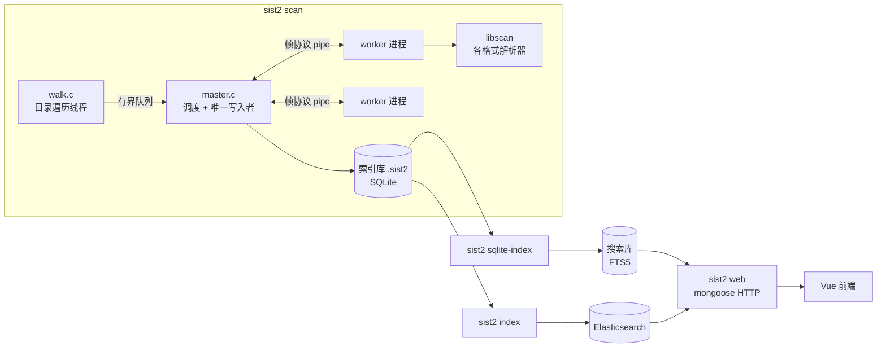
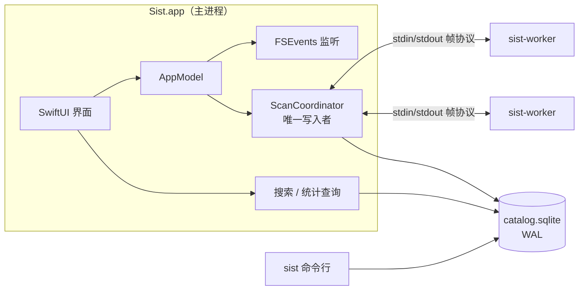
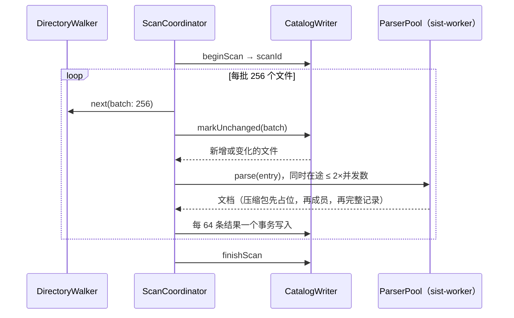

# Sist for macOS：架构设计

本文说明如何参照 sist2 的框架思路，用 macOS 原生技术重新实现一个同类应用：先回顾 sist2 的架构，再逐个模块给出 macOS 上的对应方案，最后是数据模型、关键算法、权限分发和路线图。

代码在本目录（`macos/`），构建与运行方法见 [README](../README.md)。

---

## 1. 目标与范围

**目标**：一个 macOS 原生的本地文件全文搜索应用，保留 sist2 的核心能力：

- 扫描文件夹，提取文件名、正文、元数据和缩略图
- 增量扫描：只解析新增或变化的文件
- 压缩包内的文件作为独立文档索引（递归）
- 全文搜索，支持过滤（类型、文件夹、大小、时间、标签）和排序
- 手动标签、统计页面
- OCR

**和 sist2 的主要区别**：

| | sist2 | Sist for macOS |
|---|---|---|
| 形态 | 命令行 + Web 界面（Vue）+ Docker 管理后台 | SwiftUI 原生应用，附带同库的命令行工具 |
| 解析依赖 | MuPDF、ffmpeg、LibRaw、tesseract、libmagic 等 C 库 | 系统框架：PDFKit、ImageIO、Vision、AVFoundation、CoreText、QuickLook |
| 搜索后端 | Elasticsearch 或 SQLite FTS5 | 只用 SQLite FTS5（GRDB） |
| 更新方式 | 手动或定时重新扫描 | FSEvents 监听变化，自动增量扫描 |
| 中文搜索 | SQLite 后端不切分中文 | CJK bigram 改写，任意长度中文子串都能搜到 |
| 分发 | Docker / 静态二进制 | Developer ID 签名 + 公证的 .app（不开沙盒） |

**不在第一阶段的内容**：Elasticsearch 后端、Web 界面、用户脚本、多用户鉴权、embedding 语义搜索（放在路线图第三阶段）。

---

## 2. sist2 架构回顾

以下基于本仓库源码（`src/`、`libscan/`、`sist2-vue/`）整理。



关键设计点（新实现全部继承）：

1. **遍历与解析分离，有界队列反压**。`walk.c` 生产任务，`scan_master_submit()` 在队列满时阻塞，遍历不会远远跑在解析前面。
2. **多进程 worker 隔离崩溃与超时**。`master.c` 维护一组长驻 `sist2 scan --worker` 进程，用 8 字节帧头（类型 + 长度）的协议通信（`protocol.h`），每个 worker 同时只有一个任务；超时或崩溃时杀掉并替换，不影响整体扫描。worker 用 fd 3/4 传帧，避免库函数往 stdout 打印时破坏协议。
3. **唯一写入者**。只有 master 写索引库，SQLite 不存在写竞争。
4. **增量扫描**（`database.c`）：扫描开始把所有文档 id 复制到 `marked` 表；遍历时 path + mtime 都没变的文件直接标记、不解析；结束时把未变化压缩包的子文档递归标记，剩下未标记的进 `delete_list` 并删除。
5. **版本号**：每次扫描在 `version` 表加一行，文档记录写入它的版本，下游（ES / FTS 建索引）只处理新版本的文档。
6. **子文档**：压缩包、邮件里的成员用 `压缩包路径#/成员路径` 作为路径，`parent` 指向容器。
7. **索引库与搜索库分离**：扫描输出可移植的 `.sist2` 文件，再单独建 ES 或 FTS5 索引。FTS5 用 contentless 表 + `bm25(8, 3, 8, 5)` 权重（name、content、title、path），摘要高亮由 `highlight.c` 自己从原文切。
8. **预计算统计**：treemap、大小/日期/类型分布在扫描结束时算好存表。

---

## 3. sist2 模块 → macOS 方案

| sist2 | 作用 | macOS 方案 | 位置 |
|---|---|---|---|
| `io/walk.c` | 目录遍历、排除、深度 | `DirectoryWalker`：`opendir/readdir/lstat` 拉取式迭代器；`.sistignore`（兼容 `.sist2ignore`）；包（.app/.rtfd）当单文件 | `SistCore` |
| `ignorelist.c`（libgit2） | gitignore 规则 | `IgnoreList`：自己实现 glob → 正则，支持 `!`、`**`、锚定、目录规则 | `SistCore` |
| `parsing/mime.c` + libmagic | 类型识别 | 扩展名表 → `UTType` → 文件头嗅探（`MimeTypes.sniff`） | `SistCore` / `DocumentParser` |
| `worker/master.c` | 任务调度、worker 池 | `ScanCoordinator` + `ParserPool` | `SistScan` |
| `worker/worker.c` | 解析进程 | `sist-worker` 可执行文件，打包在 .app 里 | `sist-worker` |
| `worker/protocol.c` | 帧协议 | `FrameChannel`：同样的 8 字节帧头，载荷 JSON，缩略图走二进制帧 | `SistCore` |
| `database/*.c` | 索引库 + 搜索库 | 单一 catalog 库（GRDB），文档行与 FTS 行在同一事务写入 | `SistStore` |
| `web/highlight.c` | 摘要与高亮 | `Highlighter`：从原文按查询词切摘要 | `SistCore` |
| `web/serve.c` + Vue | 界面 | SwiftUI：`NavigationSplitView` 三栏 + QuickLook | `App/` |
| `sist2-admin` | 任务调度 | FSEvents 自动增量扫描 + 菜单命令 | `App/` |
| libscan/ebook（MuPDF） | PDF/EPUB | PDFKit（PDF）、ZIPFoundation + XMLParser（EPUB） | `SistExtractors` |
| libscan/media（ffmpeg） | 图片/音视频 | ImageIO（图片、RAW、EXIF/GPS）、AVFoundation（音视频） | `SistExtractors` |
| libscan/raw（LibRaw） | 相机 RAW | ImageIO（系统支持的 RAW 格式） | `SistExtractors` |
| tesseract | OCR | Vision `VNRecognizeTextRequest`（离线，支持简繁中日韩） | `SistExtractors` |
| libscan/ooxml | docx/xlsx/pptx | ZIPFoundation + XMLParser | `SistExtractors` |
| libantiword | .doc | AppKit `NSAttributedString`（也处理 rtf/rtfd/odt） | `SistExtractors` |
| libscan/font（FreeType） | 字体 | CoreText 读名称，QuickLook 出预览图 | `SistExtractors` |
| libscan/arc（libarchive） | 压缩包 | ZIPFoundation（zip/jar/cbz）；tar/7z/rar 见路线图 | `SistExtractors` |
| 各格式缩略图 | 缩略图 | 解析器自带缩略图，否则用 QuickLookThumbnailing 兜底（Office、iWork、视频、字体、应用图标…） | `SistExtractors` |
| OpenSSL SHA1 | 校验和 | CryptoKit `Insecure.SHA1` | `DocumentParser` |
| D3 统计图 | 统计页 | Swift Charts | `App/` |

---

## 4. 总体架构

### 4.1 进程



- 主进程负责界面、扫描调度和所有写入；查询走 GRDB 的读连接，WAL 模式下扫描写入不阻塞搜索。
- `sist-worker` 是独立的小可执行文件（不加载 AppKit/SwiftUI），放在 `Sist.app/Contents/MacOS/`。数量默认等于 CPU 核心数，长驻复用，崩溃或超时就杀掉并替换。
- 命令行工具 `sist` 和应用共用 `~/Library/Application Support/Sist/catalog.sqlite`。

### 4.2 模块依赖

```
SistCore        无依赖：模型、MIME、中文分词改写、查询解析、高亮、遍历、忽略规则、worker 协议
  ├─ SistStore      + GRDB：catalog 数据库、增量写入、搜索、统计
  ├─ SistExtractors + ZIPFoundation：各格式解析器、DocumentParser
  │    └─ sist-worker   解析进程
  └─ SistScan       = Store + Extractors：扫描调度、解析池
       ├─ sist          命令行（swift-argument-parser）
       └─ SistApp       SwiftUI 应用（仅 macOS）
```

`SistCore`、`SistStore`、`SistScan` 以及通用解析器不依赖任何 Apple 专有框架，可以在 Linux 上编译和跑测试；PDFKit、Vision 等解析器和 App 用 `#if canImport(...)` / `#if os(macOS)` 隔离。这样核心逻辑可以在任何 CI 上验证。

---

## 5. 数据模型

sist2 把扫描结果（索引库）和搜索索引（FTS 库 / ES）分成两个文件，是因为它要支持两种搜索后端。这里只有一个后端，合并成一个库，好处是：文档和它的 FTS 行在同一个事务里写入，搜索索引永远不会过期，也不需要 sist2 的 `index_state.dirty` 机制。

大字段单独成表（`content`、`thumbnail`），`document` 行保持很小：列表、排序、分面计数、逐文件的增量比对只读小行。（sist2 的 `database_schema.c` 注释里也提到 `json_data` 让聚合查询读 GB 级数据的问题。）

| 表 | 说明 |
|---|---|
| `source` | 被索引的文件夹（相当于 sist2 的一个 index）：名称、根路径、扫描选项（JSON）、最后扫描时间 |
| `scan` | 每次扫描一行，id 即“版本号”；记录状态（running/completed/cancelled/failed）和计数 |
| `document` | 每个文件 / 压缩包成员一行：路径、名称、扩展名、MIME、类别、大小、mtime、标题、元数据 JSON、校验和、解析错误、缩略图数量、`scanId`（最后一次解析它的扫描）、`seenScanId`（最后一次在磁盘上看到它的扫描）。`(sourceId, path)` 唯一；`parentId` 指向所在压缩包，级联删除 |
| `content` | 正文（截断到 `contentSizeLimit`），用于摘要和预览 |
| `thumbnail` | 缩略图（JPEG，有透明度时 PNG），`WITHOUT ROWID` |
| `tag` | 手动标签 |
| `document_fts` | FTS5 虚表：name、title、content、path（相对源根目录的上级目录），存的是 CJK 改写后的文本；`bm25(8, 8, 3, 5)` 持久化为默认 rank |

触发器：删除 `document` 行（包括外键级联删除的子文档）时同步删除 FTS 行。

---

## 6. 扫描流水线与增量算法



**增量判断**用 `seenScanId`，效果等同 sist2 的 `marked` 表，但不需要每次扫描复制全部 id：

1. `markUnchanged`：对每个遍历到的顶层文件执行
   `UPDATE document SET seenScanId = :scan WHERE sourceId = ? AND path = ? AND mtime = ? AND size = ?`，
   命中（`changes = 1`）说明没变，不解析；没命中的才交给解析池。
2. `write`：解析结果按 `(sourceId, path)` upsert，`scanId = seenScanId = 当前扫描`，id 保持不变，所以标签不会丢。
3. `finishScan`：
   - 未变化的压缩包没有被解析，里面的成员也就没人标记。用递归 CTE 从“本次看到但未重新解析”（`seenScanId = :scan AND scanId < :scan`）的文档出发，把所有后代标记为已见。
   - 删除本源中 `seenScanId < :scan` 的文档；外键级联删除成员、正文、缩略图、标签，触发器清理 FTS。
4. **扫描被取消或失败时不执行第 3 步**，不会因为没遍历完而误删文件；下一次扫描从头再来。

**压缩包成员的顺序**：成员行需要引用父文档 id，所以 `DocumentParser` 在发出第一个成员之前先发出一次压缩包的占位记录，全部成员之后再发出完整记录（upsert 覆盖）。嵌套压缩包同理，最大嵌套深度 8。

**反压**：遍历是拉取式迭代器，每批 256 个；在途解析任务超过 2 倍并发数时先收结果再继续遍历，内存不会随目录规模增长。

**自动更新**：App 用 FSEvents 监听每个源（2 秒合并），有变化后 10 秒再增量扫描；扫描中又发生变化则在结束后补一次。catalog 所在目录和隐藏文件的事件会被忽略，避免自己的写入触发扫描。由于未变化文件只做一次 `UPDATE`，几十万文件的增量扫描主要耗时在遍历上。

---

## 7. 解析器

`DocumentParser` 对每个文件：识别类型 → 选第一个接受该类型的解析器 → 解析（压缩包成员递归走同一流程）→ 若没有缩略图则用 QuickLook 兜底 → 可选 SHA-1。解析器抛错时文件仍按文件名、路径入库，错误写入 `document.error`，界面可见。

| 格式 | 实现 | 正文 | 缩略图 | 元数据 | 平台 |
|---|---|---|---|---|---|
| txt、md、csv、源代码、字幕、eml | `PlainTextExtractor`，BOM → UTF-8 → 系统编码探测（GB18030、Big5、Shift-JIS…） | ✓ | — | — | 全部（Linux 无 GBK 探测） |
| html、xhtml、xml、svg、fb2 | `MarkupExtractor`，去标签、跳过 script/style、解实体 | ✓ | QuickLook | 标题 | 全部 |
| json、ndjson | `JSONExtractor`，收集所有字符串值 | ✓ | — | — | 全部 |
| docx、xlsx、pptx | `OOXMLExtractor` | ✓ | 内嵌缩略图 | 标题、作者、最后修改者 | 全部 |
| epub | `EPUBExtractor`，按 spine 顺序 | ✓ | 封面 | 标题、作者 | 全部 |
| zip、jar | `ZipArchiveExtractor`，成员作为子文档 | 列表模式 | — | 成员数 | 全部 |
| cbz | 同上，只取第一页做缩略图 | — | ✓ | — | macOS |
| pdf | `PDFExtractor`（PDFKit），无文字层的页可 OCR | ✓ | 首页 | 标题、作者、页数 | macOS |
| 图片、相机 RAW、HEIC | `ImageExtractor`（ImageIO），可 OCR | OCR、EXIF 注释、IPTC | ✓ | 尺寸、EXIF、GPS | macOS |
| 音频、视频 | `MediaExtractor`（AVFoundation） | 注释 | 视频帧 / 封面 | 时长、编码、尺寸、码率、艺术家、专辑 | macOS |
| ttf、otf、ttc、woff | `FontExtractor`（CoreText） | 字体名 | QuickLook | 字族、样式 | macOS |
| rtf、rtfd、doc、odt | `RichTextExtractor`（NSAttributedString） | ✓ | QuickLook | 标题、作者 | macOS |
| pages、numbers、key、.app 等 | 不解析正文 | — | QuickLook（应用取图标） | — | macOS |

**为什么用系统框架**：不需要打包和维护 ffmpeg、MuPDF、tesseract 等大型 C 依赖（sist2 的 vcpkg 冷编译要几个小时），体积小，自动获得系统对新格式（HEIC、AVIF、新相机 RAW）的支持；Vision 的中文 OCR 效果和速度都好于 tesseract。代价是 AVFoundation 不支持 mkv/avi/wmv，这些文件只有文件名和 QuickLook 缩略图（见第 12 节）。

---

## 8. 搜索

### 8.1 中文分词

SQLite 自带的 `unicode61` 分词器只按分隔符切分，一整段中文会变成一个超长 token，搜其中的词什么也搜不到（sist2 的 SQLite 后端也有这个问题）。这里在写入 FTS 前改写文本：

- 每段连续的 CJK 字符（中日韩，含假名、谚文）展开为重叠二元组，再加上最后一个字：`文档管理` → `文档 档管 管理 理`
- 其他文字原样交给 `unicode61`；全角字母数字先做 NFKC 归一化

查询用同样的方式改写成 FTS5 短语（连续 token）：

| 输入 | FTS5 表达式 | 说明 |
|---|---|---|
| `文档管理` | `"文档 档管 管理"` | 任意长度子串都能命中 |
| `档` | `"档"*` | 单字以前缀匹配二元组 |
| `iPhone手机` | `"iPhone 手机"` | 中英混排 |
| `文字b` | `"文字 字 b"` | 中文后面还有内容时，要求原文的中文段也在此结束 |

这样不依赖词典，召回和子串匹配一致，不会出现分词器切错导致搜不到的情况。代价是 FTS 中 CJK 文本约为原来的 2.3 倍。改写规则有单元测试和端到端测试覆盖（`SearchTextTests`、`CJKSearchTests`）。

### 8.2 查询语法

查询由 `QueryParser` 转成 FTS5 表达式，所有词都加引号转义，任何输入都不会产生 FTS5 语法错误：

```
季度报告            包含该词（中文子串也可以）
"quick brown"       短语
photo*              前缀
-草稿               排除
合同 OR 协议        或（也可以写 |），OR 只绑定两侧的词：a b OR c d = a AND (b OR c) AND d
name:报告           只在某一列搜：name、title、content、path
```

### 8.3 排序、高亮、分面

- 相关度：FTS5 `rank`，列权重与 sist2 相同（文件名 8、标题 8、正文 3、路径 5）；无关键词时按修改时间
- 其他排序：修改时间、大小、名称
- 摘要：`Highlighter` 在原文中找查询词，选覆盖不同词最多、命中最密的窗口；文件名、详情页正文同样高亮
- 分面：每次搜索同时统计各类别的命中数（不受当前类别筛选影响），驱动侧边栏
- 过滤：文件夹、类别、MIME、路径前缀、大小、时间、标签（同时具备多个标签）、是否包含压缩包成员

---

## 9. 界面

```
┌────────────┬──────────────────────────────┬────────────────────┐
│ 文件夹      │ 🔍 搜索文件名、内容、路径…     │  [缩略图]           │
│  ✓ 文稿     │ ┌──┐ 季度报告.pdf             │  季度报告           │
│    照片     │ │  │ ~/文稿/工作               │  ~/文稿/工作/…       │
│ 类型        │ └──┘ …华东地区【销售】数据…     │  打开 快速查看 显示   │
│  文档  120  │ ┌──┐ 销售数据.xlsx            │  信息：类型 大小 …   │
│  图片   45  │ └──┘ …                       │  标签：+ 添加        │
│ 标签        │                               │  内容（高亮）        │
│  重要    3  │ 1,234 个结果 · 12 ms          │                    │
└────────────┴──────────────────────────────┴────────────────────┘
```

- 三栏 `NavigationSplitView`：侧边栏（文件夹、类型分面、标签，点击切换筛选）、结果（列表 / 缩略图网格，滚动到底自动加载下一页）、详情（大缩略图、元数据、标签编辑、高亮正文）
- 空格键或“快速查看”调用系统 QuickLook；双击打开，右键可在 Finder 中显示、拷贝路径
- 工具栏：搜索框（输入防抖 180 ms）、显示方式、排序、统计窗口
- 统计窗口（Swift Charts）：按类型占用空间、大小分布、修改年份、最大的文件夹、常见格式
- 设置：默认扫描选项、每个文件夹的选项（OCR、语言、缩略图、正文上限、压缩包模式、排除规则、并发、超时）、权限说明

---

## 10. 进程隔离与容错

与 sist2 相同的协议思路（`WorkerProtocol.swift`）：

```
帧 = UInt32 类型 + UInt32 长度（小端） + 载荷
扫描 → worker：configure(ScanOptions) · job(FileEntry) · bye
worker → 扫描：document(ParsedDocument) · thumbnail(JPEG，属于上一个 document) · log · done
```

- 每个 worker 同时只处理一个任务，读写不会互相死锁
- worker 启动时 `dup` 一份 stdout 专门写帧，再把 fd 1 指向 stderr，框架的打印不会污染协议（sist2 用 fd 3/4 达到同样目的）
- 超时（默认 60 秒，可配置）：看门狗 `SIGKILL` 该 worker，读端收到 EOF，任务以“超时”结束，下个任务换新 worker
- 崩溃：同样表现为 EOF；已收到的部分结果保留
- 失败的文件仍以文件名入库并记录错误
- 主进程忽略 `SIGPIPE`，向已死的 worker 写入只会返回错误
- 找不到 `sist-worker` 时（例如 `swift run`）退回进程内解析（`InProcessParserPool`），没有崩溃隔离，会记录警告

这些行为都有测试（`ScanCoordinatorTests.crashedAndHungParsersOnlyCostTheirFile` 通过测试钩子让 worker 崩溃和卡死）。

---

## 11. 权限、签名与分发（Developer ID）

- **不开 App Sandbox**：可以直接读用户添加的任意路径，能启动 `sist-worker` 子进程，不需要 security-scoped bookmark
- **TCC**：首次访问“文稿”“桌面”“下载”、外置磁盘、网络磁盘时系统会弹窗，`Info.plist` 已写好对应的用途说明；子进程的访问归属到 App 本身。要索引“邮件”“信息”等，需要用户授予“完全磁盘访问权限”（设置页有直达按钮）
- **签名与公证**：`scripts/make-app.sh` 构建 arm64 + x86_64 通用二进制，组装 `.app`，先签内部可执行文件再签 App，启用 Hardened Runtime；设置 `NOTARY_PROFILE` 时自动 `notarytool submit --wait` 并 `stapler staple`
- **命令行工具**：随 App 打包在 `Contents/MacOS/sist`，可软链接到 `/usr/local/bin`

---

## 12. 已知限制

| 限制 | 原因 | 计划 |
|---|---|---|
| tar、gz、7z、rar 不展开 | macOS SDK 不提供 libarchive 头文件 | 阶段二：打包 libarchive（XCFramework） |
| mkv、avi、wmv 无元数据 | AVFoundation 不支持 | 阶段二：可选 ffprobe/ffmpeg 插件，或只依赖 QuickLook 扩展 |
| Windows 生成的 zip 中文文件名可能乱码 | 未设置 UTF-8 标志的 zip 按 CP437 解码 | 阶段一：检测并用 GB18030 重新解码 |
| mobi、azw3、djvu、pst、mbox 未解析正文 | 尚未实现 | 阶段二 |
| iWork（pages/numbers/key）无正文 | 私有格式（IWA/protobuf） | 阶段三：读取内置预览 PDF 或 Spotlight 导入器 |
| FTS 存储改写后的文本，CJK 正文约 2.3 倍体积 | 系统 SQLite 版本不确定是否支持 contentless_delete | 阶段二：打包较新的 SQLite 后改为 contentless 表 |
| 进程内模式无法中止卡住的解析 | 线程不能被安全杀死 | 正式包始终使用 sist-worker |
| 模糊搜索（sist2 的 spellfix） | 系统 SQLite 未编译 spellfix | 阶段二：基于 trigram 表的建议 |

---

## 13. 性能考虑

- 遍历用 `readdir` + `lstat`，不经过 `FileManager` 的属性字典
- 增量比对每文件一条带索引的 `UPDATE`，256 个一个事务
- 解析结果 64 条一个事务；`document` 行不含大字段
- 正文默认上限 32K 字符（同 sist2 的 `--content-size`），文本类文件只读需要的字节
- 缩略图默认 552 px（同 sist2），JPEG 质量 0.7；界面侧有 `NSCache`
- 搜索分页 100 条，摘要只为当前页计算
- 统计用覆盖索引上的聚合（`document_category`、`document_size`、`document_mtime`）

---

## 14. 路线图

**阶段一（当前骨架 → 可日常使用）**
- [x] 引擎：遍历、增量、worker 池、catalog、CJK 搜索、统计、CLI
- [x] 解析器：文本、HTML、JSON、Office、EPUB、ZIP、PDF、图片 + OCR、音视频、字体、RTF/DOC/ODT、QuickLook 缩略图
- [x] SwiftUI：三栏搜索界面、筛选、详情、标签、统计、设置、FSEvents 自动更新
- [ ] 在 Mac 上完整走查界面，补应用图标
- [ ] zip 中文文件名编码修正
- [ ] 详情页“在压缩包中浏览”（`Catalog.children(of:)` 已有）
- [ ] 菜单栏常驻 + 全局快捷键唤出搜索面板（类似 Spotlight/Alfred）

**阶段二（格式与后台）**
- [ ] libarchive：tar/gz/bz2/xz/7z/rar
- [ ] mobi/azw3、mbox/eml MIME 解析、pst
- [ ] 后台扫描移到登录项 agent（`SMAppService`），关闭窗口后继续更新
- [ ] 模糊搜索建议、路径补全、保存的搜索
- [ ] Finder 标签与应用标签双向同步（`URLResourceValues.tagNames`）

**阶段三（语义搜索，对应 sist2 的 embeddings）**
- [ ] 文本：`NLContextualEmbedding` 或 Core ML 版多语言句向量，按段落分块（对应 sist2 的 per-chunk embeddings）
- [ ] 图片：Vision `VNGenerateImageFeaturePrintRequest` 以图搜图；Core ML 版 CLIP 以文搜图
- [ ] 向量存储：先线性扫描（与 sist2 SQLite 后端一致），规模大时换 HNSW

---

## 15. 验证状态

| 部分 | 验证方式 |
|---|---|
| SistCore、SistStore、SistScan、通用解析器、sist、sist-worker | Linux（Swift 6.2）上编译通过，50 个单元/集成测试通过，并用 CLI 做了端到端测试（中文搜索、增量扫描、压缩包、worker 崩溃与超时） |
| PDFKit/ImageIO/Vision/AVFoundation/CoreText/QuickLook 解析器、SwiftUI App | 需要 macOS 编译。`.github/workflows/macos-app.yml` 在 GitHub 的 macOS runner 上编译、跑测试并打包 .app |
