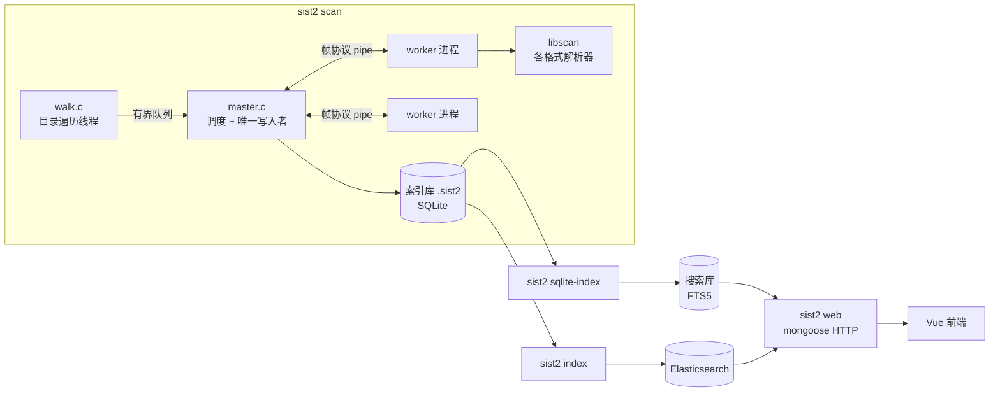
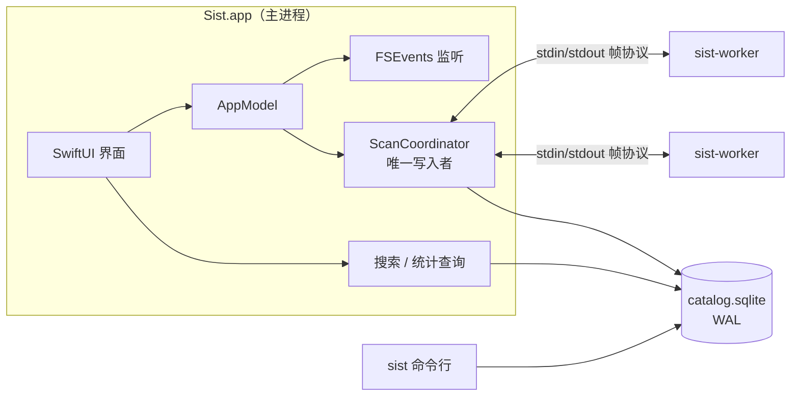
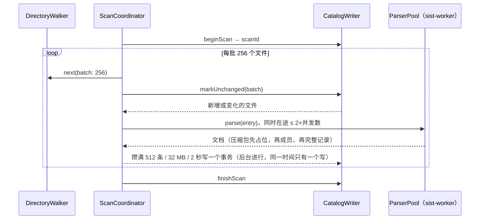

# Sist for macOS：架构设计

本文说明如何参照 sist2 的框架思路，用 macOS 原生技术重新实现一个同类应用：先回顾 sist2 的架构，再逐个模块给出 macOS 上的对应方案，最后是数据模型、关键算法、权限分发和路线图。

代码在本目录（`macos/`），构建与运行方法见 [README](../README.md)。

---

## 1. 目标与范围

**目标**：一个 macOS 原生的本地文件全文搜索应用，保留 sist2 的核心能力：

- 扫描文件夹，提取文件名、正文、元数据和缩略图
- 增量扫描：只解析新增或变化的文件
- 压缩包内的文件作为独立文档索引（递归）
- 全文搜索，支持过滤（类型、文件夹、大小、时间、标签）和排序
- 手动标签、统计页面
- OCR

**和 sist2 的主要区别**：

| | sist2 | Sist for macOS |
|---|---|---|
| 形态 | 命令行 + Web 界面（Vue）+ Docker 管理后台 | SwiftUI 原生应用，附带同库的命令行工具 |
| 解析依赖 | MuPDF、ffmpeg、LibRaw、tesseract、libmagic 等 C 库 | 系统框架：PDFKit、ImageIO、Vision、AVFoundation、CoreText、QuickLook |
| 搜索后端 | Elasticsearch 或 SQLite FTS5 | 只用 SQLite FTS5（GRDB） |
| 更新方式 | 手动或定时重新扫描 | FSEvents 监听变化，自动增量扫描 |
| 中文搜索 | SQLite 后端不切分中文 | CJK 按单字索引、按短语查询，任意长度中文子串都能搜到 |
| 分发 | Docker / 静态二进制 | Developer ID 签名 + 公证的 .app（不开沙盒） |

**不在第一阶段的内容**：Elasticsearch 后端、Web 界面、用户脚本、多用户鉴权、embedding 语义搜索（放在路线图第三阶段）。

---

## 2. sist2 架构回顾

以下基于本仓库源码（`src/`、`libscan/`、`sist2-vue/`）整理。



关键设计点（新实现全部继承）：

1. **遍历与解析分离，有界队列反压**。`walk.c` 生产任务，`scan_master_submit()` 在队列满时阻塞，遍历不会远远跑在解析前面。
2. **多进程 worker 隔离崩溃与超时**。`master.c` 维护一组长驻 `sist2 scan --worker` 进程，用 8 字节帧头（类型 + 长度）的协议通信（`protocol.h`），每个 worker 同时只有一个任务；超时或崩溃时杀掉并替换，不影响整体扫描。worker 用 fd 3/4 传帧，避免库函数往 stdout 打印时破坏协议。
3. **唯一写入者**。只有 master 写索引库，SQLite 不存在写竞争。
4. **增量扫描**（`database.c`）：扫描开始把所有文档 id 复制到 `marked` 表；遍历时 path + mtime 都没变的文件直接标记、不解析；结束时把未变化压缩包的子文档递归标记，剩下未标记的进 `delete_list` 并删除。
5. **版本号**：每次扫描在 `version` 表加一行，文档记录写入它的版本，下游（ES / FTS 建索引）只处理新版本的文档。
6. **子文档**：压缩包、邮件里的成员用 `压缩包路径#/成员路径` 作为路径，`parent` 指向容器。
7. **索引库与搜索库分离**：扫描输出可移植的 `.sist2` 文件，再单独建 ES 或 FTS5 索引。FTS5 用 contentless 表 + `bm25(8, 3, 8, 5)` 权重（name、content、title、path），摘要高亮由 `highlight.c` 自己从原文切。
8. **预计算统计**：treemap、大小/日期/类型分布在扫描结束时算好存表。

---

## 3. sist2 模块 → macOS 方案

| sist2 | 作用 | macOS 方案 | 位置 |
|---|---|---|---|
| `io/walk.c` | 目录遍历、排除、深度 | `DirectoryWalker`：`opendir/readdir/lstat` 拉取式迭代器；`.sistignore`（兼容 `.sist2ignore`）；包（.app/.rtfd）当单文件 | `SistCore` |
| `ignorelist.c`（libgit2） | gitignore 规则 | `IgnoreList`：自己实现 glob → 正则，支持 `!`、`**`、锚定、目录规则 | `SistCore` |
| `parsing/mime.c` + libmagic | 类型识别 | 扩展名表 → `UTType` → 文件头嗅探（`MimeTypes.sniff`） | `SistCore` / `DocumentParser` |
| `worker/master.c` | 任务调度、worker 池 | `ScanCoordinator` + `ParserPool` | `SistScan` |
| `worker/worker.c` | 解析进程 | `sist-worker` 可执行文件，打包在 .app 里 | `sist-worker` |
| `worker/protocol.c` | 帧协议 | `FrameChannel`：同样的 8 字节帧头，载荷 JSON，缩略图走二进制帧 | `SistCore` |
| `database/*.c` | 索引库 + 搜索库 | 单一 catalog 库（GRDB），文档行与 FTS 行在同一事务写入 | `SistStore` |
| `web/highlight.c` | 摘要与高亮 | `Highlighter`：从原文按查询词切摘要 | `SistCore` |
| `web/serve.c` + Vue | 界面 | SwiftUI：`NavigationSplitView` 三栏 + QuickLook | `App/` |
| `sist2-admin` | 任务调度 | FSEvents 自动增量扫描 + 菜单命令 | `App/` |
| libscan/ebook（MuPDF） | PDF/EPUB | PDFKit（PDF）、ZIPFoundation + XMLParser（EPUB） | `SistExtractors` |
| libscan/media（ffmpeg） | 图片/音视频 | ImageIO（图片、RAW、EXIF/GPS）、AVFoundation（音视频） | `SistExtractors` |
| libscan/raw（LibRaw） | 相机 RAW | ImageIO（系统支持的 RAW 格式） | `SistExtractors` |
| tesseract | OCR | Vision `VNRecognizeTextRequest`（离线，支持简繁中日韩） | `SistExtractors` |
| libscan/ooxml | docx/xlsx/pptx | ZIPFoundation + XMLParser | `SistExtractors` |
| libantiword | .doc | AppKit `NSAttributedString`（也处理 rtf/rtfd/odt） | `SistExtractors` |
| libscan/font（FreeType） | 字体 | CoreText 读名称，QuickLook 出预览图 | `SistExtractors` |
| libscan/arc（libarchive） | 压缩包 | 同样用 libarchive：macOS 系统自带（/usr/lib，只是没有头文件），`CArchive` 目标声明用到的函数并链接 `-larchive` | `CArchive` / `SistExtractors` |
| （sist2 不支持） | xls、ppt | 自己解析：OLE2 复合文档容器 + Excel BIFF8 共享字符串 + PowerPoint 文本记录 | `SistExtractors` |
| 各格式缩略图 | 缩略图 | 解析器自带缩略图，否则用 QuickLookThumbnailing 兜底（Office、iWork、视频、字体、应用图标…） | `SistExtractors` |
| OpenSSL SHA1 | 校验和 | CryptoKit `Insecure.SHA1` | `DocumentParser` |
| D3 统计图 | 统计页 | Swift Charts | `App/` |

---

## 4. 总体架构

### 4.1 进程



- 主进程负责界面、扫描调度和所有写入；查询走 GRDB 的读连接，WAL 模式下扫描写入不阻塞搜索。
- `sist-worker` 是独立的小可执行文件（不加载 AppKit/SwiftUI），放在 `Sist.app/Contents/MacOS/`。数量默认等于 CPU 核心数，长驻复用，崩溃或超时就杀掉并替换。
- 命令行工具 `sist` 和应用共用 `~/Library/Application Support/Sist/catalog.sqlite`。

### 4.2 模块依赖

```
SistCore        无依赖：模型、MIME、中文分词改写、查询解析、高亮、遍历、忽略规则、worker 协议
  ├─ SistStore      + GRDB：catalog 数据库、增量写入、搜索、统计
  ├─ SistExtractors + ZIPFoundation：各格式解析器、DocumentParser
  │    └─ sist-worker   解析进程
  └─ SistScan       = Store + Extractors：扫描调度、解析池
       ├─ sist          命令行（swift-argument-parser）
       └─ SistApp       SwiftUI 应用（仅 macOS）
```

`SistCore`、`SistStore`、`SistScan` 以及通用解析器不依赖任何 Apple 专有框架，可以在 Linux 上编译和跑测试（需要 `libsqlite3-dev`、`libarchive-dev`）；PDFKit、Vision 等解析器和 App 用 `#if canImport(...)` / `#if os(macOS)` 隔离。这样核心逻辑可以在任何 CI 上验证。

---

## 5. 数据模型

sist2 把扫描结果（索引库）和搜索索引（FTS 库 / ES）分成两个文件，是因为它要支持两种搜索后端。这里只有一个后端，合并成一个库，好处是：文档和它的 FTS 行在同一个事务里写入，搜索索引永远不会过期，也不需要 sist2 的 `index_state.dirty` 机制。

大字段单独成表（`content`、`thumbnail`），`document` 行保持很小：列表、排序、分面计数、逐文件的增量比对只读小行。（sist2 的 `database_schema.c` 注释里也提到 `json_data` 让聚合查询读 GB 级数据的问题。）

| 表 | 说明 |
|---|---|
| `source` | 被索引的文件夹（相当于 sist2 的一个 index）：名称、根路径、扫描选项（JSON）、最后扫描时间、`indexedOptions`（最后一次完整扫描所用的选项，见第 6 节“重建”） |
| `scan` | 每次扫描一行，id 即“版本号”；记录状态（running/completed/cancelled/failed）和计数 |
| `document` | 每个文件 / 压缩包成员一行：路径、名称、扩展名、MIME、类别、大小、mtime、标题、元数据 JSON、校验和、解析错误、缩略图数量、`scanId`（最后一次解析它的扫描）、`seenScanId`（最后一次在磁盘上看到它的扫描）。`directory`（磁盘上文件所在的目录，压缩包成员为空）。`(sourceId, path)` 唯一；`parentId` 指向所在压缩包，级联删除 |
| `content` | 正文（截断到 `contentSizeLimit`），用于摘要和预览。512 字节以上的用 zlib 压缩成 BLOB（前 4 字节是原文长度），短的仍是 TEXT（`ContentCodec`）；中文约压到一半，英文约三分之一。压缩在扫描的并行任务里做，写入者只负责写 |
| `thumbnail` | 缩略图（JPEG，有透明度时 PNG），`WITHOUT ROWID` |
| `tag` | 手动标签 |
| `folder` | 每个含有文件的目录及其下（递归）的文件数和总大小，每次扫描结束时重建，驱动侧边栏的文件夹树（sist2 的 `path_index`） |
| `document_fts` | FTS5 虚表：name、title、content、path（相对源根目录的上级目录），写入的是 CJK 改写后的文本；`bm25(8, 8, 3, 5)` 持久化为默认 rank。和 sist2 一样是 contentless 表（`content=''`），不另存一份文本，摘要从 `content` 表切；删除行需要 SQLite 3.43 的 `contentless_delete`（macOS 14 起），更老的 SQLite 保留普通 FTS 表 |

触发器：删除 `document` 行（包括外键级联删除的子文档）时同步删除 FTS 行。

---

## 6. 扫描流水线与增量算法



**增量判断**用 `seenScanId`，效果等同 sist2 的 `marked` 表，但不需要每次扫描复制全部 id：

1. `markUnchanged`：对每个遍历到的顶层文件执行
   `UPDATE document SET seenScanId = :scan WHERE sourceId = ? AND path = ? AND mtime = ? AND size = ?`，
   命中（`changes = 1`）说明没变，不解析；没命中的才交给解析池。
2. `write`：解析结果按 `(sourceId, path)` upsert，`scanId = seenScanId = 当前扫描`，id 保持不变，所以标签不会丢。重新解析的文件先删掉它原有的压缩包成员（本次解析会重新发出现有的成员），压缩包里被删掉的文件就这样消失。
3. `finishScan`：删除本源中本次没有看到的磁盘文件（`parentId IS NULL AND seenScanId < :scan`）；外键级联删除它们的成员、正文、缩略图、标签，触发器清理 FTS。未变化的压缩包既没被解析也没被重新标记，它的成员原样保留。最后重建 `folder` 表。
4. **扫描被取消或失败时不执行第 3 步**，不会因为没遍历完而误删文件；下一次扫描从头再来。

**重建**：选项里有一部分只影响“走哪些文件”（深度、排除规则、隐藏文件、文件包、并发、超时），改了以后下一次遍历自然会增删文件；其余的影响“怎么解析”（OCR、语言、正文上限、缩略图、压缩包模式、校验和……），改了以后已有文件必须重新解析才会生效。`source.indexedOptions` 记录最后一次完整扫描所用的选项，下一次扫描发现解析相关的选项变了，就跳过增量比对、重新解析全部文件（`ScanOptions.changesExtraction`，新增的选项默认算作解析相关）。也可以手动“重建索引”。

**局部扫描**：扫描可以只限于若干目录（`ScanScope`：一个目录，含或不含子目录）。遍历只走这些目录，删除也只发生在其中（非递归时按 `document.directory` 匹配，递归时按路径前缀）。目录本身仍要遵守源的规则：从源根到它的路径上有隐藏、被忽略、被排除的目录，或超出深度限制，就不遍历；文件包内部的变化换成扫描包所在的目录；已不存在的目录则删除其中原有的文档。重建和源的第一次扫描总是覆盖整个源。

**压缩包成员的顺序**：成员行需要引用父文档 id，所以 `DocumentParser` 在发出第一个成员之前先发出一次压缩包的占位记录，全部成员之后再发出完整记录（upsert 覆盖）。嵌套压缩包同理，最大嵌套深度 8。

**反压**：遍历是拉取式迭代器，每批 256 个；在途解析任务超过 2 倍并发数时先收结果再继续遍历，内存不会随目录规模增长。

**自动更新**：用 FSEvents（文件级事件）监听每个源，2 秒合并一次，10 秒内的变化攒在一起做一次局部扫描（`ChangeScopes`）：变化的文件 → 扫描它所在的目录（不含子目录，增、改、删都能发现）；变化的目录（移入、移出、改名）→ 扫描它及其下全部；FSEvents 丢了事件或根目录变了 → 扫描整个源。catalog 所在目录和隐藏文件的事件会被忽略，避免自己的写入触发扫描。

调度由 `ScanScheduler`（actor，可在 Linux 上测试）负责：每个源同一时间只有一个扫描；扫描进行中又来的请求合并成一次，在它之后执行（有一个是重建就重建，有一个是整个源就扫整个源）；进行中的变化在扫描结束后补扫；整源扫描会吸收之前攒下的变化。`IndexKeeper` = 一组 FSEvents 监视器 + 一个 `ScanScheduler`。

**访达标签**：遍历时顺带读每个文件的访达标签（扩展属性 `com.apple.metadata:_kMDItemUserTags`，二进制 plist，每个文件一次 `getxattr`），记在 `document.finderTags`。改标签不改修改时间，所以增量比对把标签也算进去：标签变了的文件会被重新解析（FSEvents 对扩展属性的改动也有事件，局部扫描能及时发现）。写入时只应用“上次解析时的访达标签”与“这次的”之差：访达里新加的标签加入，访达里删掉的移除，在 App 里给压缩包成员等加的标签不受影响。反过来，在 App 里给磁盘上的文件加、删标签，会通过 `NSURL` 的 `tagNamesKey` 写回访达（Swift 的 `URLResourceValues.tagNames` 是只读的），并更新 `finderTags`，下次扫描不会把它当成访达里的改动。

**后台服务**：`Sist.app/Contents/Library/LoginItems/SistAgent.app` 是一个没有界面的登录项（`LSBackgroundOnly`），在设置里打开“登录后在后台保持索引更新”时由 App 用 `SMAppService.loginItem` 注册并启动。它运行一个 `IndexKeeper`，启动时先对每个源做一次增量扫描（补上没人监视期间的变化，未变化的文件每个只需一次 `stat`），之后靠 FSEvents 更新；退出 Sist 后照常工作。
- 谁来扫描由 `ScanLock` 决定：catalog 旁边一个文件上的 `flock`。后台服务运行期间一直持有它；App 能拿到锁就自己扫描、监视，拿不到就说明后台服务在运行，扫描请求转给它。进程不管怎么退出，系统都会释放锁
- App 与后台服务之间用分布式通知（`AgentLink`）：扫描、取消、源有变化、查询状态、退出几种请求，以及扫描进度和完成事件（JSON），界面上的进度条与本地扫描时一样。数据本身都在共享的 catalog 里（WAL 模式，一写多读），不需要传
- 交接：启用后台服务时 App 先停掉本地扫描、放开锁，后台服务拿到锁后广播“已启动”，App 改为转发；停用时 App 发“退出”，后台服务放开锁，App 收到“已停止”后重新拿锁、恢复本地扫描。后台服务意外退出时锁随之释放，App 每 30 秒检查一次，发现锁空着就接手
- 后台服务用 App 里的 `sist-worker`（`WorkerLocator` 会到外层 App 的 `Contents/MacOS` 里找）；`make-app.sh` 把它打进包里并先于 App 签名

**写入**：只有一个写入者。解析结果攒够 512 条、32 MB 或 2 秒就交给后台写一个事务，写的同时继续给解析器派活；下一次写入要等上一次完成，所以写入仍然串行、内存有上限。CJK 改写这类 CPU 工作在解析任务里并行做完，不占写入者的时间。FTS5 每次提交都会落一个段，大事务能明显减少段合并（同样 1 万个文档：64 条一个事务 1.95 秒，1024 条 1.03 秒）。

---

## 7. 解析器

`DocumentParser` 对每个文件：识别类型 → 选第一个接受该类型的解析器 → 解析（压缩包成员递归走同一流程）→ 若没有缩略图则用 QuickLook 兜底 → 可选 SHA-1。解析器抛错时文件仍按文件名、路径入库，错误写入 `document.error`，界面可见。

| 格式 | 实现 | 正文 | 缩略图 | 元数据 | 平台 |
|---|---|---|---|---|---|
| txt、md、csv、源代码、字幕 | `PlainTextExtractor`，BOM → UTF-8 → 系统编码探测（GB18030、Big5、Shift-JIS…） | ✓ | — | — | 全部（Linux 只回退到 GB18030） |
| html、xhtml、xml、svg、fb2 | `MarkupExtractor`，去标签、跳过 script/style、解实体 | ✓ | — | 标题 | 全部 |
| json、ndjson | `JSONExtractor`，收集所有字符串值 | ✓ | — | — | 全部 |
| docx、xlsx、pptx | `OOXMLExtractor` | ✓ | 内嵌缩略图 | 标题、作者、最后修改者 | 全部 |
| epub | `EPUBExtractor`，按 spine 顺序 | ✓ | 封面 | 标题、作者 | 全部 |
| mobi、azw、azw3、prc | `MobiExtractor`：Palm 数据库 → PalmDOC（LZ77）解压 → 去标签；MOBI 6 和 KF8（azw3）都支持，两者合订的读 MOBI 6 部分 | ✓ | 封面 | 标题、作者、出版社、主题、语言 | 全部（缩略图仅 macOS） |
| eml、emlx | `MailExtractor`：头字段、正文（纯文本优先，没有时取 HTML 去标签）；附件和转发的邮件作为成员 | ✓ | — | 主题、发件人、收件人、抄送、时间 | 全部 |
| mbox | `MailExtractor`：逐行读取（可达数 GB），每封邮件作为成员，再递归它的附件 | 主题列表 | — | 邮件数 | 全部 |
| msg | `OutlookExtractor`：复合文档里的 MAPI 属性；附件、嵌入的邮件作为成员 | ✓ | — | 同 eml | 全部 |
| pst、ost | `OutlookExtractor` + `PSTFile`：按需随机读取（不整个读进内存），每封邮件作为成员 `文件夹/00001 主题.eml`，再递归附件 | 主题列表 | — | 邮件数 | 全部 |
| xls、xlt | `OLEOfficeExtractor`：工作表名 + 共享字符串表（所有文本单元格） | ✓ | QuickLook | 标题、作者、最后修改者 | 全部 |
| ppt、pps、pot | `OLEOfficeExtractor`：幻灯片、备注、文本框的文字，跳过母版 | ✓ | QuickLook | 标题、作者、最后修改者 | 全部 |
| tar（含 .tar.gz/.tgz/.tar.bz2/.tar.xz）、7z、rar、zip、jar、iso、cab、cpio | `ArchiveExtractor`（libarchive），成员作为子文档递归索引；也可只列文件名 | 列表模式 | — | 成员数 | 全部 |
| 单文件压缩 .gz、.bz2、.xz、.zst | 同上，解压出的单个文件作为成员（report.txt.gz → report.txt） | — | — | — | 全部 |
| cbz、cbr | `ComicBookExtractor`（libarchive），按文件名取第一页做缩略图，页面不单独索引 | — | ✓ | 页数 | 缩略图仅 macOS |
| pdf | `PDFExtractor`（PDFKit），无文字层的页可 OCR | ✓ | 首页 | 标题、作者、页数 | macOS |
| 图片、相机 RAW、HEIC | `ImageExtractor`（ImageIO），可 OCR | OCR、EXIF 注释、IPTC | ✓ | 尺寸、EXIF、GPS | macOS |
| 音频、视频 | `MediaExtractor`（AVFoundation） | 注释 | 视频帧 / 封面 | 时长、编码、尺寸、码率、艺术家、专辑 | macOS |
| ttf、otf、ttc、woff | `FontExtractor`（CoreText） | 字体名 | QuickLook | 字族、样式 | macOS |
| rtf、rtfd、doc、odt | `RichTextExtractor`（NSAttributedString） | ✓ | QuickLook | 标题、作者 | macOS |
| pages、numbers、key、.app 等 | 不解析正文 | — | QuickLook（应用取图标） | — | macOS |

**压缩包成员的文件名**：libarchive 按当前 locale 转换文件名，而 App 和 worker 运行在 C locale 下，7z、rar 里的中文名在那里会直接丢失。`ArchiveReader` 在每次调用 libarchive 时把本线程切到 UTF-8 locale（`uselocale`，不影响进程其他部分）。没有声明编码的名字（Windows 中文系统打的 zip、老 tar）按“合法 UTF-8 → GB18030 → Latin-1”的顺序解码。

**xls / ppt**：没有系统框架能读这两种格式，所以自己解析。先读 OLE2 复合文档容器（FAT、DIFAT、mini stream、目录树），再从 `\u0005SummaryInformation` 取标题、作者（按其中声明的代码页解码），然后：
- xls：遍历 Workbook 流的 BIFF8 记录，取工作表名（BOUNDSHEET）和共享字符串表（SST）。SST 会被拆进多个 CONTINUE 记录，字符串在记录边界处断开时，下一段开头有一个新的标志字节，决定后面是单字节还是双字节字符，这是最容易出错的地方，测试用 3000 条中英文交替、跨 11 个 CONTINUE 记录的文件逐条核对
- ppt：按流顺序遍历记录，进入容器，取 TextCharsAtom / TextBytesAtom，跳过母版和讲义（只有“单击此处编辑母版标题样式”这类提示），重复文本只保留一次
- 加密文件只索引文件名和元数据。所有读取都做边界检查，损坏文件的模糊测试（随机改写/截断 300 次）不会崩溃或死循环

**mobi / azw3**：Palm 数据库的第 0 条记录是 PalmDOC 头 + MOBI 头 + EXTH 元数据（作者 100、出版社 101、简介 103、主题 105、更新后的标题 503、语言 524、封面 201），之后的文本记录是 HTML（KF8 为 XHTML），通常用 PalmDOC 的 LZ77 压缩。每条文本记录末尾可能附带阅读器用的尾部数据（索引信息、被记录边界截断的多字节字符），由 MOBI 头的 extra flags 描述，按位倒序读变长整数去掉，否则正文里会混入乱码。用古登堡计划的《論語》MOBI 6 和 KF8 两个版本测试。HUFF/CDIC 压缩（少数亚马逊自产书）和 DRM 加密的书只有元数据。

**邮件**：自己实现 RFC 5322 / MIME，不依赖系统框架：
- 头字段：折行展开；RFC 2047 编码词（`=?GBK?B?…?=`），相邻的同字符集编码词合并后再解码（邮件程序常把一个汉字的字节拆到两个编码词里）；没有编码直接写 8 位字节的头字段按“UTF-8 → GB18030”解码
- 参数：引号、转义、RFC 2231 的 `filename*=utf-8''%E4%B8%AD` 和分段 `filename*0*=`；Outlook 和国内邮箱常把编码词直接放进引号里的文件名，也能解
- 正文：base64、quoted-printable；按 charset 解码（GBK/GB2312 → GB18030、Big5、Shift-JIS、EUC-KR、ISO-2022-JP…）；multipart/alternative 取纯文本版本，没有时取 HTML 去标签
- 附件（有文件名或标为 attachment 的部分）和 message/rfc822（转发的邮件）作为成员，路径如 `邮件.eml#/报价单.xlsx`，再按类型递归解析；重名加序号。压缩包模式同样适用：不处理或只列名时只记附件名
- mbox 按行读取，邮件以空行后的 `From ` 行分隔，正文里的 `>From ` 按 mboxrd 还原；每封邮件命名为 `00001 主题.eml` 作为成员
- 在界面里打开附件时，`ArchiveMemberReader` 按同样的命名规则重新解析容器取出字节，支持多层（mbox → 邮件 → 附件 → 压缩包 → 文件）

**Outlook（msg、pst）**：同样不依赖第三方库，按 [MS-OXMSG]、[MS-PST] 实现：
- msg 是复合文档（复用 xls/ppt 的 OLE2 读取器），`__substg1.0_IIIITTTT` 流是变长属性，`__properties_version1.0` 流是定长属性；收件人、附件是子存储，转发的邮件是附件里的子存储
- pst 分三层：节点数据库（NDB：按块号定位块的 B 树、列出所有节点的 B 树；节点的数据是一个块或一棵块树，外加一棵子节点树）、列表表格属性层（LTP：节点数据里的堆、堆里的 B 树、其上的属性上下文）、消息层（文件夹、邮件都是节点，附件是邮件的子节点）。支持 ANSI（Outlook 97–2002）和 Unicode 两种格式、两种加密（compressible 置换表、high 循环加密，表格与规范及 libpst、libpff 一致）；新版 .ost 的 4K 页格式不支持
- 正文依次取纯文本、HTML（去标签）、压缩 RTF（[MS-OXRTFCP] 的 LZFu 解压后提取文字：跳过字体表等目标组，`\'hh` 按 `\ansicpg` 代码页解码，`\uN` 取字符并跳过替代字符）
- 8 位字符串按邮件的 `PidTagInternetCodepage` / `PidTagMessageCodepage` 解码；没有代码页的（ANSI 文件里的文件夹名）按“UTF-8 → GB18030”猜
- pst 里的邮件、msg 里嵌入的邮件都转成 MIME（`MessageSummary.rfc822()`：UTF-8 编码词、base64 附件）作为 `.eml` 成员，之后附件的索引、在界面里打开（`ArchiveMemberReader`）都和普通邮件一样，例如 `备份.pst#/收件箱/00001 报价.eml#/报价单.xlsx`
- 测试文件：Linux 上没有能写 msg/pst 的工具，所以由 `Fixtures/outlook.py` 按规范生成，再用独立的实现校验——extract-msg 读 msg，libpst 的 readpst 和 libpff（pypff）读 pst，两者读出的文件夹、邮件、正文、附件都一致——之后才用于测试。另有随机改写/截断 250 次的损坏文件测试

**为什么用系统框架**：不需要打包和维护 ffmpeg、MuPDF、tesseract 等大型 C 依赖（sist2 的 vcpkg 冷编译要几个小时），体积小，自动获得系统对新格式（HEIC、AVIF、新相机 RAW）的支持；Vision 的中文 OCR 效果和速度都好于 tesseract。代价是 AVFoundation 不支持 mkv/avi/wmv，这些文件只有文件名和 QuickLook 缩略图（见第 12 节）。

---

## 8. 搜索

### 8.1 中文分词

SQLite 自带的 `unicode61` 分词器只按分隔符切分，一整段中文会变成一个超长 token，搜其中的词什么也搜不到（sist2 的 SQLite 后端也有这个问题）。这里在写入 FTS 前改写文本：

- 每个 CJK 字符（中日韩，含假名、谚文）单独成为一个 token：`文档管理` → `文 档 管 理`
- 其他文字原样交给 `unicode61`；全角字母数字、全角标点先做 NFKC 归一化

查询用同样的方式改写成 FTS5 短语（位置连续的 token）：

| 输入 | FTS5 表达式 | 说明 |
|---|---|---|
| `文档管理` | `"文 档 管 理"` | 任意长度子串都能命中 |
| `档` | `"档"` | 单字就是一个 token |
| `iPhone手机` | `"iPhone 手 机"` | 中英混排 |
| `报告*` | `"报 告"*` | 前缀只作用于最后一个 token |

这样不依赖词典，召回和子串匹配一致，不会出现分词器切错导致搜不到的情况；PDF 提取出的文本常在词中间换行，单字短语也能跨行匹配（代价是也会跨标点匹配，比如“中，国”能被“中国”搜到，实际很少见）。改写规则有单元测试和端到端测试覆盖（`SearchTextTests`、`CJKSearchTests`）。

**为什么不用二元组（bigram）**：最早的实现和很多中文全文检索一样，把每段中文展开成重叠二元组（`文档 档管 管理 理`）。用 1.2 万篇维基百科和维基新闻（74 MB 中文正文）及其 8 倍复制（9.6 万篇、600 MB）实测：

| | 二元组 | 单字 |
|---|---|---|
| FTS 索引（1.2 万篇 / 9.6 万篇） | 112 MB / 788 MB | 56 MB / 436 MB |
| 写入 FTS 的时间（9.6 万篇） | 238 秒 | 61 秒 |
| 多字词查询，前 100 条（9.6 万篇） | 1–35 ms | 15–155 ms |
| 单字查询“的”，前 100 条（9.6 万篇） | 1.7 秒（只能用前缀查询） | 0.16 秒 |

二元组的每个 (词, 文档) 条目只出现一两次，条目开销（文档号、长度、列号、位置）比文字本身还大；单字词表只有几千个，条目集中、位置差值小。多字查询变慢是因为要读常用字很长的位置列表，但在 10 万篇大文档的规模下仍在 0.2 秒以内，而单字查询（边输入边搜时的第一个字）快了一个数量级。连同正文压缩，整个 catalog 在中文语料上从 204 MB 降到 107 MB，扫描从 30 秒降到 15 秒。旧的 catalog 打开时由 v4 迁移重建索引、压缩正文，再 `VACUUM` 释放空间。

### 8.2 建议与保存的搜索

- **拼写建议**（代替 sist2 依赖的 SQLite spellfix 扩展，系统 SQLite 没有它）：`document_vocab` 是 FTS5 的 `fts5vocab` 虚表，直接列出索引里的词和包含它的文档数，不另占空间、不用维护。搜索没有结果时，对每个索引里没有的拉丁字母词，在首字母相同、长度相差不超过 2 的词里找编辑距离（含相邻换位）最小、文档最多的一个（短词最多 1 处、长词最多 2 处差异），替换后的查询确实有结果才给出“您是不是要找……”。命令行同样提示 `Did you mean`
- **文件夹与路径补全**：输入时，搜索框下列出名字包含正在输入的词的文件夹（按文件数排序）；输入以 `/` 或 `~` 开头时按路径前缀补全。选中即把搜索限定到该文件夹
- **保存的搜索**：关键词连同全部筛选（源、文件夹、类型、大小、时间、标签、排序）存进 catalog 的 `saved_search` 表，侧边栏列出，可重命名、删除；时间预设按名字保存（“最近 7 天”在每次使用时重新计算）。搜索框输入时也会列出名字匹配的保存的搜索

### 8.3 语义搜索（对应 sist2 的 embeddings）

默认关闭（设置 › 通用，或 `sist semantic --on`），因为分析要花时间。开启后：

- **文本**：正文按约 400 字切成段落（在换行、句末处断开，每个文档最多 8 段，即开头约 3000 字；`Chunker` 是确定的，搜索时用同样的切法找出命中的段落做摘要），每段用 NaturalLanguage 的 `NLContextualEmbedding`（macOS 14）得到各 token 的向量，取平均作为段落向量。系统按文字体系提供不同的模型（拉丁、西里尔、中日韩……），首次用到时自动下载；不同模型的向量不在同一个空间，所以向量带着模型标识存储，中文查询只和中文段落比较
- **图片**：用已存的缩略图跑 Vision 的 `VNGenerateImageFeaturePrintRequest`（特征向量，用于“查找相似图片”）和 `VNClassifyImageRequest`（置信度 0.3 以上的前 8 个内容标签，如 beach、cat、document）。标签写进文档的元数据（详情页“图片内容”）和全文索引行，所以搜“beach”能找到海滩照片；标签是英文的
- **何时计算**：与解析分开，由 `SemanticIndexer` 在每次扫描结束后在后台补齐（App 或后台服务里的 `IndexKeeper` 负责），也可以 `sist semantic --update`。`embedding_status` 记录每个文档分析时的解析版本（scan id），文档重新解析后自动重新分析；模型还在下载时文档保持待处理，下次再试
- **存储**：`embedding` 表，每段一行，向量归一化后量化为 8 位（每个向量一个缩放系数），空间是 32 位浮点的四分之一，相似度几乎不变
- **检索**：线性扫描同一模型的全部向量（与 sist2 的 SQLite 后端一致），每个文档取最相似的段落，留前 500 个（扫描细节见第 13 节）；同时取全文检索的前 500 个，用倒数排名融合（RRF，k=60）合成一个排序——两种分数不在同一尺度，排名融合不需要校准。筛选条件对两路同样生效；按时间、大小、名称排序时对融合后的结果排序。摘要显示命中的那一段
- **界面**：工具栏“按意思搜索”开关；图片详情里“查找相似图片”（结果上方显示“与 xxx 相似”的筛选标签）；命令行 `sist search --semantic`、`--semantic-only`，`sist similar 图片路径`
- **测试**：Linux 上没有这些系统模型，测试用一个确定性的哈希嵌入器和假图片分析器覆盖切段、量化、存储、补齐、过期重算、融合检索、相似图片和标签检索；NaturalLanguage/Vision 部分只在 macOS 上编译

### 8.4 查询语法

查询由 `QueryParser` 转成 FTS5 表达式，所有词都加引号转义，任何输入都不会产生 FTS5 语法错误：

```
季度报告            包含该词（中文子串也可以）
"quick brown"       短语
photo*              前缀
-草稿               排除
合同 OR 协议        或（也可以写 |），OR 只绑定两侧的词：a b OR c d = a AND (b OR c) AND d
name:报告           只在某一列搜：name、title、content、path
```

### 8.5 排序、高亮、分面

- 相关度：FTS5 `rank`，列权重与 sist2 相同（文件名 8、标题 8、正文 3、路径 5）；无关键词时按修改时间
- 其他排序：修改时间、大小、名称
- 摘要：`Highlighter` 在原文中找查询词，选覆盖不同词最多、命中最密的窗口；文件名、详情页正文同样高亮
- 分面：每次搜索同时统计各类别的命中数（不受当前类别筛选影响），驱动侧边栏
- 过滤：文件夹、类别、MIME、路径前缀、大小、时间、标签（同时具备多个标签）、是否包含压缩包成员

---

## 9. 界面

```
┌────────────┬──────────────────────────────┬────────────────────┐
│ 文件夹      │ 🔍 搜索文件名、内容、路径…     │  [缩略图]           │
│  ✓ 文稿     │ ┌──┐ 季度报告.pdf             │  季度报告           │
│    照片     │ │  │ ~/文稿/工作               │  ~/文稿/工作/…       │
│ 类型        │ └──┘ …华东地区【销售】数据…     │  打开 快速查看 显示   │
│  文档  120  │ ┌──┐ 销售数据.xlsx            │  信息：类型 大小 …   │
│  图片   45  │ └──┘ …                       │  标签：+ 添加        │
│ 标签        │                               │  内容（高亮）        │
│  重要    3  │ 1,234 个结果 · 12 ms          │                    │
└────────────┴──────────────────────────────┴────────────────────┘
```

- 三栏 `NavigationSplitView`：侧边栏（源 → 可展开的文件夹树，带递归文件数；类型分面；标签；点击切换筛选）、结果（列表 / 缩略图网格，滚动到底自动加载下一页）、详情（大缩略图、元数据、标签编辑、高亮正文）
- 结果上方以可删除的小标签显示当前生效的筛选（源、文件夹、类型、大小、时间、标签）
- 详情页列出压缩包内容，可以点进成员（包括嵌套的压缩包）再返回；成员显示“位于压缩包 xxx”的链接
- 空格键或“快速查看”调用系统 QuickLook；双击打开，右键可在 Finder 中显示、拷贝路径。压缩包里的文件会先解压到临时目录再打开或预览（`ArchiveMemberReader`，支持多层嵌套）
- 工具栏：搜索框（输入防抖 180 ms）、显示方式、排序、筛选（大小预设；修改时间预设 + 自定义起止日期）、统计窗口
- 右键菜单：源可以“立即扫描”“重建索引”；文件夹可以“重新扫描此文件夹”
- 统计窗口（Swift Charts）：按类型占用空间、大小分布、修改年份、最大的文件夹、常见格式
- 设置：快速搜索的快捷键和菜单栏图标、默认扫描选项、每个文件夹的选项（OCR、语言、缩略图、正文上限、压缩包模式、排除规则、并发、超时；改动需要重新解析全部文件时会提示）、“重建索引”、权限说明
- 快速搜索面板（类似 Spotlight / Alfred）：任何应用中按快捷键（默认 ⌥空格，可选 ⌃⌥空格、⇧⌘空格；⌘空格是 Spotlight 的，⌃空格是切换输入法的）在鼠标所在屏幕上方弹出搜索框，前 30 个结果随输入更新。↑↓ 选择，↩ 打开，⌘↩ 在 Finder 中显示，⇧↩ 把查询带到主窗口看全部结果，Esc 或点别处关闭
  - 快捷键用 Carbon 的 `RegisterEventHotKey`：不需要辅助功能权限，按键也不会传给前台应用；被其他应用占用时设置里会提示
  - 面板是 `nonactivatingPanel`：接收键盘输入但不激活 Sist，原来的窗口仍在前面；打开文件后自动消失
  - 方向键和回车由本地事件监视器处理，但输入法正在组字时（拼音、假名）一律交给输入法：回车上屏、方向键选词、Esc 取消，不会误打开文件
- 菜单栏图标：快速搜索、打开主窗口、扫描状态与“扫描全部”、设置、退出。显示菜单栏图标时，关闭主窗口后应用继续运行（快捷键可用、文件夹监视继续更新索引）；隐藏时关闭主窗口即退出
- 应用图标由 `scripts/make-icon.py` 画出 1024 px 的 `App/Icon/AppIcon.png`，`make-app.sh` 用 `sips` 和 `iconutil` 生成 `AppIcon.icns`
- 打开旧版本的 catalog 可能要迁移（第 8.1 节），在后台线程进行，界面显示“正在打开索引…”

---

## 10. 进程隔离与容错

与 sist2 相同的协议思路（`WorkerProtocol.swift`）：

```
帧 = UInt32 类型 + UInt32 长度（小端） + 载荷
扫描 → worker：configure(ScanOptions) · job(FileEntry) · bye
worker → 扫描：document(ParsedDocument) · thumbnail(JPEG，属于上一个 document) · log · done
```

- 每个 worker 同时只处理一个任务，读写不会互相死锁
- worker 启动时 `dup` 一份 stdout 专门写帧，再把 fd 1 指向 stderr，框架的打印不会污染协议（sist2 用 fd 3/4 达到同样目的）
- 超时（默认 60 秒，可配置）：任务连续这么久没有产出任何文档时，看门狗 `SIGKILL` 该 worker，读端收到 EOF，任务以“超时”结束，下个任务换新 worker。按“无产出”而不是总时长计算，是因为一个几 GB 的压缩包、mbox 或 pst 会持续产出成员，总时长远超 60 秒也是正常的；为防万一，总时长仍以 30 倍超时为上限
- 崩溃：同样表现为 EOF；已收到的部分结果保留
- 失败的文件仍以文件名入库并记录错误
- 主进程忽略 `SIGPIPE`，向已死的 worker 写入只会返回错误
- 找不到 `sist-worker` 时（例如 `swift run`）退回进程内解析（`InProcessParserPool`），没有崩溃隔离，会记录警告

这些行为都有测试（`ScanCoordinatorTests.crashedAndHungParsersOnlyCostTheirFile` 通过测试钩子让 worker 崩溃和卡死）。

---

## 11. 权限、签名与分发（Developer ID）

- **不开 App Sandbox**：可以直接读用户添加的任意路径，能启动 `sist-worker` 子进程，不需要 security-scoped bookmark
- **TCC**：首次访问“文稿”“桌面”“下载”、外置磁盘、网络磁盘时系统会弹窗，`Info.plist` 已写好对应的用途说明；子进程的访问归属到 App 本身。要索引“邮件”“信息”等，需要用户授予“完全磁盘访问权限”（设置页有直达按钮）
- **签名与公证**：`scripts/make-app.sh` 构建 arm64 + x86_64 通用二进制，组装 `.app`，先签内部可执行文件再签 App，启用 Hardened Runtime；设置 `NOTARY_PROFILE` 时自动 `notarytool submit --wait` 并 `stapler staple`
- **命令行工具**：随 App 打包在 `Contents/Helpers/sist`（放在 `Contents/MacOS` 里会和 App 本身的可执行文件 `Sist` 在不区分大小写的卷上成为同一个文件），可软链接到 `/usr/local/bin`

---

## 12. 已知限制

| 限制 | 原因 | 计划 |
|---|---|---|
| mkv、avi、wmv 无元数据 | AVFoundation 不支持 | 阶段二：可选 ffprobe/ffmpeg 插件，或只依赖 QuickLook 扩展 |
| 加密的压缩包成员、加密的 xls/ppt 只有文件名 | 没有密码 | 可以像 sist2 一样加一个密码选项 |
| Excel 5.0/95（BIFF5）不支持 | 只实现了 BIFF8（Excel 97 起） | 按需 |
| xls 只索引文本单元格，不含数字和公式结果 | 只读共享字符串表 | 按需读 NUMBER/RK 记录 |
| ppt 按流顺序取文本，反复编辑过的文件里旧版本的文字也可能被索引 | 没有解析持久化目录 | 按需 |
| 没有声明编码的日文 Shift-JIS、繁体 Big5 文件名会解错 | 无法可靠区分，优先按简体中文 GB18030 解码 | 设置中提供文件名编码选项 |
| djvu 未解析正文 | 尚未实现 | 按需（DjVuLibre 体积不小） |
| Outlook 2013 起的 4K 页 .ost 不支持 | 页、块格式不同，块还可能被压缩 | 按需 |
| HUFF/CDIC 压缩或 DRM 加密的 mobi/azw 只有元数据 | 前者少见，后者没有密钥 | 按需 |
| iWork（pages/numbers/key）无正文 | 私有格式（IWA/protobuf） | 阶段三：读取内置预览 PDF 或 Spotlight 导入器 |
| macOS 13 及更老的 SQLite（< 3.43）用不了 contentless FTS，索引大一些 | `contentless_delete` 需要 3.43 | 部署目标是 macOS 14，实际不会遇到 |
| 极宽泛的查询（命中大部分文档）要按相关度给全部命中打分，10 万文档约 0.2 秒，百万级约 2 秒 | bm25 排序需要遍历全部命中 | 命中过多时改按时间排序或只对前 N 个打分 |
| 中文按单字索引，常用字组成的词要读很长的位置列表：10 万篇大文档约 0.1–0.2 秒 | 换来索引减半、写入快 4 倍、单字搜索快 10 倍（第 8.1 节） | 规模再大时可以只为高频字对加二元组 |
| 进程内模式无法中止卡住的解析 | 线程不能被安全杀死 | 正式包始终使用 sist-worker |
| 语义搜索按文字体系分模型，中文查询找不到意思相同的英文段落 | 系统的上下文向量模型是按文字体系分开的 | 换成多语言句向量模型（需随 App 分发） |
| 图片内容标签是英文的 | Vision 的分类体系只有英文标识 | 为常见标签加中文对照 |
| 语义检索是线性扫描：20 万个向量约 200 ms，随向量数线性增长 | 先求简单可靠 | 规模更大时换 HNSW，或常驻内存的二值量化粗筛 + 8 位精排 |
| 拼写建议只纠正拉丁字母的词，且假定首字母没错 | 中文按单字索引，无所谓拼写；首字母相同的词才进候选，避免扫全部词表 | 按需 |

---

## 13. 性能

实测（Linux，4 核虚拟机，release 构建；macOS 上解析器不同，但流水线和数据库部分相同）。

**中英混合小文件**：10 万个 1–3 KB 的文本文件，约 1000 个目录，中文是随机挑字组成、以空格分开的短词：

| 场景 | 结果 |
|---|---|
| 首次扫描（sist-worker 子进程） | 50 秒（约 2000 文件/秒），峰值内存 169 MB |
| catalog 大小 | 258 MB（原文 395 MB；FTS 102 MB，正文 79 MB，`document` 及其索引约 70 MB） |
| 无变化重扫 | 1.9 秒 |
| 1% 文件修改 + 100 个删除后重扫 | 2.9 秒 |
| 局部扫描一个 100 个文件的目录 | 0.2 秒 |
| 罕见词 / 精确短语 / 文件夹名 | 3 ms / 114 ms（5303 个命中）/ 39 ms |
| 命中 90% 文档的单词搜索 | 223 ms（瓶颈是给 9 万个命中打 bm25 分） |
| 只按文件夹筛选（无关键词） | 130 ms（App 里同时限定了源，能用上 `(sourceId, path)` 索引） |

**真实中文**：1.2 万篇中文维基新闻和维基百科条目（74 MB，平均 6 KB，长的截断到 32K 字）：

| 场景 | 结果 |
|---|---|
| 首次扫描 | 15 秒 |
| catalog 大小 | 107 MB（FTS 56 MB，压缩后的正文 41 MB） |
| “的” / “中国” / “联合国” / “方济各”，前 100 条含摘要 | 140 / 55 / 30 / 28 ms |

两轮优化的前后对比：

| | 最初 | 第一轮 | 现在 |
|---|---|---|---|
| 混合 10 万文件：扫描 / catalog | 92 秒 / 564 MB | 59 秒 / 324 MB | 50 秒 / 258 MB |
| 中文 1.2 万篇：扫描 / catalog | — | 30 秒 / 204 MB | 15 秒 / 107 MB |
| 中文单字“的”，前 100 条 | — | 667 ms | 140 ms |

第一轮：剖析发现 84% 的时间花在唯一的写入者上，且写入时解析器空等。改动：FTS 改为 contentless（体积 -43%）、写入攒大事务（512 条 / 32 MB / 2 秒）、CJK 改写挪到并行的解析任务、写入与解析重叠、搜索的总数直接由分面计数求和（少扫一遍命中）、没有关键词时不切摘要。第二轮针对中文：CJK 由二元组改为单字（第 8.1 节）、正文 zlib 压缩、摘要的解压和匹配在多个核上并行（一页 100 条的摘要原本比查询本身还慢）。FTS 的 `optimize` 在单字索引上只能再省 1%，没有采用。

**语义检索**：20 万个 512 维图片向量（8 位量化，catalog 152 MB），“查找相似图片”一次 580 ms → 205 ms。改动：
- `embedding` 表主键改为 `(model, documentId, kind, chunk)`：一次检索读的是一段连续的键区间，且已按文档分组，每个文档的最佳段落边读边定，不必先收集再归并（按文档删除走另一个索引 `embedding_document`）
- 只保留前 N 个文档的小顶堆，代替全部打分后排序
- 绕过 GRDB 的行对象，直接用 SQLite C API 逐行读、在原地读向量 blob（不复制）：同样的扫描，GRDB 的行层要多花约 140 ms
- 点积用 `SIMD16`：8 位整数一次转换 16 个，单独测 20 万次点积 125 ms → 41 ms

剩下的主要是 SQLite 本身逐行读出 100 MB 向量的成本（同样的循环用 C 写约 165 ms），再快就要离开“每个向量一行”：常驻内存的向量，或 HNSW。

其他：
- 遍历用 `readdir` + `lstat`，不经过 `FileManager` 的属性字典
- 增量比对每文件一条带索引的 `UPDATE`，256 个一个事务
- `document` 行不含大字段；WAL + `synchronous=NORMAL`
- 正文默认上限 32K 字符（同 sist2 的 `--content-size`），文本类文件只读需要的字节
- 缩略图默认 552 px（同 sist2），JPEG 质量 0.7；界面侧有 `NSCache`
- 搜索分页 100 条，摘要只为当前页计算
- 统计用覆盖索引上的聚合（`document_category`、`document_size`、`document_mtime`）

---

## 14. 路线图

**阶段一（当前骨架 → 可日常使用）**
- [x] 引擎：遍历、增量、worker 池、catalog、CJK 搜索、统计、CLI
- [x] 解析器：文本、HTML、JSON、Office、EPUB、ZIP、PDF、图片 + OCR、音视频、字体、RTF/DOC/ODT、QuickLook 缩略图
- [x] SwiftUI：三栏搜索界面、筛选、详情、标签、统计、设置、FSEvents 自动更新
- [ ] 在 Mac 上完整走查界面
- [x] 应用图标
- [x] zip 中文文件名编码修正
- [x] libarchive：tar/gz/bz2/xz/zstd/7z/rar/iso/cab，cbr 封面
- [x] 旧版 Office：xls、ppt
- [x] 详情页“在压缩包中浏览”，压缩包内文件可直接打开 / 预览
- [x] 文件夹树、大小和时间筛选、筛选标签
- [x] 解析相关的设置改变后自动重建；手动重建索引
- [x] FSEvents 只扫描变化的目录
- [x] 10 万文件基准测试与写入路径优化
- [x] 菜单栏常驻 + 全局快捷键唤出搜索面板（类似 Spotlight/Alfred）

**阶段二（格式与后台）**
- [x] mobi/azw3、eml/emlx/mbox（MIME 解析，附件作为成员）
- [x] pst（ANSI、Unicode）、msg
- [x] 后台扫描移到登录项 agent（`SMAppService`），关闭窗口、退出 App 后继续更新
- [x] 拼写建议、文件夹/路径补全、保存的搜索
- [x] 访达标签与应用标签双向同步

**阶段三（语义搜索，对应 sist2 的 embeddings）**
- [x] 文本：`NLContextualEmbedding`，按段落分块（对应 sist2 的 per-chunk embeddings），与全文检索融合排序
- [x] 图片：Vision 特征向量以图搜图；Vision 分类标签让关键词能搜到图片
- [ ] 以文搜图的 CLIP（需要随 App 分发一个 Core ML 模型，几百 MB）
- [x] 向量存储：8 位量化 + 线性扫描（与 sist2 SQLite 后端一致）
- [ ] 规模大时换 HNSW

---

## 15. 验证状态

| 部分 | 验证方式 |
|---|---|
| SistCore、SistStore、SistScan、通用解析器（含压缩包、xls/ppt）、sist、sist-worker | Linux（Swift 6.2）与 macOS 15 上编译通过，121 个单元/集成测试全部通过，压缩包和 xls/ppt 用 `Tests/SistExtractorsTests/Fixtures` 里由 rar、bsdtar、LibreOffice 生成的真实文件测试，mobi/azw3 用古登堡计划的真实电子书，邮件用 Python email 库生成的文件，msg/pst 用经 extract-msg、libpst、libpff 校验过的生成文件；另用 CLI 做了端到端测试（中文搜索、增量扫描、压缩包、worker 崩溃与超时）和 10 万文件的基准测试（第 13 节） |
| PDFKit/ImageIO/Vision/AVFoundation/CoreText/QuickLook 解析器、SwiftUI App | macOS 15 runner 上编译通过，`make-app.sh` 打出的 arm64 + x86_64 通用 `Sist.app` 通过 `codesign --verify --strict` |
| 界面交互、各 Apple 框架解析器对真实文件的效果 | 尚未验证：CI 只编译不运行界面，也没有 PDF/图片/音视频的样例文件测试。需要在 Mac 上实际走查 |

CI：`.github/workflows/macos-app.yml`，`macos/` 有改动时在 macOS 和 Linux 上各跑一遍。
